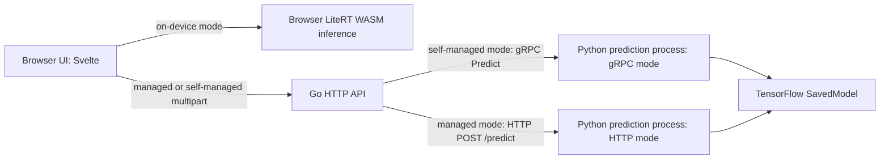

# Liveness Detection

This repository contains a browser application, a Go HTTP API, and a Python inference service for image based liveness prediction. It supports three UI choices: inference in the browser, routing through the Go API to a Python service over gRPC, and routing through the Go API to a Python HTTP service. The repository also contains local and cloud oriented Compose definitions.

The repository does not establish the implementation or behavior of any third party managed prediction provider. In the local Compose setup, the mode named `managed_service` points to another container running this repository's Python prediction service over HTTP. The term “managed” is therefore a route/mode name here, not evidence of a separately verified cloud provider.

## Quick Navigation

| Topic | Explanation | Source reference |
|---|---|---|
| Go API entry point and startup | Reads the mode argument, loads `./config.json`, initializes logger and HTTP foundation | `main.go` → `foundation.Boot` in `foundation/main.go` |
| HTTP server and middleware | Creates service graph, registers routes, starts `net/http` | `foundation.httpFoundation.Setup`, `Boot`, `Shutdown` in `foundation/http.go` |
| API route and multipart handler | `POST /inference/predict`, fields `image` and `mode` | `handler.NewHandler` in `handler/main.go`; `inferenceHandler.Predict` in `handler/inference.go` |
| Go inference routing | Base64 conversion and mode-specific HTTP/gRPC client calls | `inferenceService.Predict` in `service/inference.go` |
| Python service startup | Loads settings and model, then starts HTTP or gRPC server | `prediction/main.py` (`main`, module initialization) |
| Python HTTP interface | Health and prediction routes; request/response models | `InferenceService._register_routes`, `predict` in `prediction/service/inference.py` |
| Python gRPC interface | `InferenceService/Predict` implementation | `prediction/service/grpc/inference.py`; contract in `pb/inference.proto` |
| Model loading and execution | TensorFlow SavedModel loading, image preprocessing and score comparison | `AntiSpoofModel` in `prediction/foundation/model.py` |
| Browser flow | Camera start, crop, mode selection, result/error modal | `Main.svelte` in `application/src/Main.svelte` |
| Browser-side inference | LiteRT WebAssembly model loading and execution | `OnDeviceService.Initialize`, `Predict` in `application/src/service/on-device-service.ts` |
| Backend client adapters | Multipart requests to the Go API | `ManagedService.Predict` and `SelfManagedService.Predict` in `application/src/service/` |
| Configuration | Go JSON/env loading and Python JSON/env loading | `configuration.NewConfiguration` in `configuration/main.go`; `new_configuration` in `prediction/foundation/configuration.py` |
| HTTP client and request timing | 60-second client timeout, response decoding and duration log | `common.NewHttpClient`, `PostJson` in `common/http-client.go` |
| Logging and request IDs | API middleware generates response request ID; service logs structured JSON | `middleware/logger.go`, `common/request-id.go`, `common/logger.go`, `prediction/foundation/logger.py` |
| Container builds | Go API and browser image definitions | Root `Dockerfile`; `application/Dockerfile` and `application/nginx.conf` |
| Compose deployment | Local multi-container and cloud prediction service definitions | `_infrastructure/compose.local.yml`, `_infrastructure/compose.cloud.yml` |
| Browser end-to-end tests | Playwright tests for the three UI modes; test-side elapsed time is written to JSONL | `tests/services.spec.ts`, `tests/playwright.config.ts`, `tests/package.json` |

## Repository Structure

```text
.
├── main.go                         Go API executable
├── foundation/                     Go startup, HTTP server and lifecycle
├── configuration/                  Go configuration schema and loader
├── handler/                        HTTP route registration and request handling
├── service/                        Go inference orchestration
├── outbound/http/                  Go client for Python HTTP prediction API
├── outbound/grpc/                  Go gRPC client for Python prediction API
├── common/                         HTTP response/client, logging, request IDs, errors
├── middleware/                     CORS and request logging middleware
├── payload/                        Go API response payload
├── pb/inference.proto               Shared RPC contract source
├── prediction/                     Python HTTP/gRPC inference service
│   ├── main.py                     Python process entry point
│   ├── foundation/                 Config, model, server and logger setup
│   └── service/                     Prediction logic and HTTP/gRPC adapters
├── application/                    Svelte/TypeScript browser UI
│   ├── src/Main.svelte             Camera, capture, service choice and results
│   ├── src/service/                Browser adapters for API and on-device routes
│   └── src/inference/              Additional inference adapters
├── tests/                          Playwright browser tests
├── _infrastructure/                Compose and Loki/Alloy/Grafana configuration
├── Dockerfile                      Multi-stage Go API image build
├── example.config.json             Example Go API JSON configuration
└── prediction/example.config.json  Example Python JSON configuration
```

The `detector/` directory exists in the inspected workspace and contains a SavedModel, TFLite artifacts and generated Python protobuf files. Git status reports `detector/` as untracked in that workspace; its inclusion in a committed checkout is therefore **not verified**. In addition, current image definitions do not explicitly copy these artifacts from `detector/` into the Python image or browser build output. See [Model and Inference Integration](#model-and-inference-integration).

`application/README.md` and `prediction/README.md` contain only short headings and no additional setup instructions. Generated Go protobuf code is referenced at `pb/compiled/inference`, but it is not present in the tracked file inventory. The Python generated files appear under the untracked `detector/pb/compiled/` tree; generation/build behavior for the Go package is not configured in the Dockerfile or Go module metadata.

## Technology Stack and Dependencies

| Area | Technology | Evidence and role |
|---|---|---|
| API | Go 1.27 module; standard `net/http` server and `ServeMux` | `go.mod`, `foundation/http.go`, `handler/main.go` |
| RPC | gRPC and Protocol Buffers | Go modules in `go.mod`; contract in `pb/inference.proto`; generated Go client imports in `outbound/grpc/main.go` |
| Prediction service | Python 3.13, TensorFlow, NumPy, Pillow | `prediction/Dockerfile`, `prediction/requirements.txt`, `prediction/foundation/model.py` |
| Python interfaces | FastAPI/Uvicorn and gRPC Python | `prediction/requirements.txt`, `prediction/foundation/http.py`, `prediction/foundation/grpc.py` |
| Browser | Svelte 5, TypeScript, Vite 8, Tailwind CSS 4 | `application/package.json`, `application/vite.config.ts` |
| Browser inference | `@litertjs/core` with the WASM accelerator | `application/package.json`, `application/src/service/on-device-service.ts` |
| Browser tests | Playwright | `tests/package.json`, `tests/playwright.config.ts` |
| Containerization | Docker; Docker Compose | Root and component Dockerfiles; `_infrastructure/compose.*.yml` |
| Log collection | Grafana Alloy and Loki; Grafana datasource provisioning | `_infrastructure/config.alloy`, `_infrastructure/loki.yml`, `_infrastructure/grafana/provisioning/datasources/loki.yml` |

Versions are pinned or constrained in `go.mod`, `prediction/requirements*.txt`, `application/package.json` and lockfiles. Compose references image tags for the application services but does not define `build:` instructions for them.

## Architecture Overview

The browser can make inference locally or send a multipart request to the Go API. The Go API converts the image bytes to Base64 and dispatches to either its configured gRPC endpoint or its configured HTTP endpoint. Both Python server modes use the same `PredictionService` and `AntiSpoofModel` implementation. In the HTTP branch, the Python API accepts an `instances` JSON array and returns a `predictions` array; the gRPC branch uses the single `Predict` RPC.



The local Compose file defines browser and API containers plus two prediction containers, one started in gRPC mode and one in HTTP mode. It also defines Loki, Alloy and Grafana. The cloud Compose file defines only the self-managed prediction container. These files describe container arrangements, not proof that a cloud deployment is currently running. References: `_infrastructure/compose.local.yml`, `_infrastructure/compose.cloud.yml`.

## Application Startup and Lifecycle

### Go API

1. `main.main` passes command-line arguments to `foundation.Boot` (`main.go`). The first required argument selects a foundation; only `http` is accepted (`foundation.NewFoundation` in `foundation/main.go`).
2. `foundation.Boot` resolves `./config.json`, calls `configuration.NewConfiguration`, and creates a structured logger. The configuration loader reads the JSON file if present, then applies non-empty environment variables as overrides (`foundation/main.go`, `configuration/main.go`).
3. `httpFoundation.Setup` creates the mux, HTTP helper, outbound gRPC client, service and handler. The handler registers `POST /inference/predict`. CORS and request logging wrap the mux (`foundation/http.go`, `handler/main.go`).
4. `httpFoundation.Boot` calls `ListenAndServe` using the configured HTTP port, overridden by `HTTP_PORT` if set.
5. `mainFoundation.Boot` listens for interrupt and SIGTERM. On signal it requests shutdown with a 10-second context; `httpFoundation.Shutdown` calls `http.Server.Shutdown` (`foundation/main.go`, `foundation/http.go`).

The outbound gRPC connection has a `Close` helper (`GRPCOutboundConnection.Close`), but the startup/shutdown path does not call it. No corresponding explicit client cleanup is established for the HTTP client.

### Python prediction service

1. Import-time initialization in `prediction/main.py` loads `./config.json`, creates the logger and loads the model from `./anti-spoof-mn3` before command-line mode dispatch.
2. The required positional mode is `http` or `grpc` (`parse_args`). HTTP mode creates FastAPI/Uvicorn, registers routes, then runs Uvicorn. gRPC mode creates the server, registers the service, starts, and waits for termination.
3. HTTP graceful shutdown is exposed by `Http.shutdown`, but `main()` does not register an application shutdown hook calling it. gRPC signal handlers stop the server with a 15-second grace period (`foundation/grpc.py`).

The Python configuration loader requires application service/environment and both HTTP and gRPC port settings, regardless of which server mode is selected. There are no Python configuration defaults in the loader (`prediction/foundation/configuration.py`).

## Request and Data Flow

### Browser capture and API-backed paths

1. `Main.svelte` calls `onDeviceService.Initialize` on mount, then `startCamera` requests camera access. The UI captures a centered crop and encodes it as JPEG at 128×128 (`takeCroppedPicture` in `application/src/Main.svelte`).
2. A button selects `managed_service`, `self_managed_service`, or `on_device_service` (`execute`). The two service adapters create multipart form data with `image` and `mode`, then `fetch` `${BACKEND_URL}/inference/predict` (`application/src/service/managed-service.ts`, `self-managed-service.ts`; `BACKEND_URL` in `application/src/config.ts`).
3. Go middleware generates a UUID request ID, places it in `X-Request-Id`, and logs request start and completion duration (`middleware/logger.go`). The handler reads `image` and `mode` in `inferenceHandler.Predict` (`handler/inference.go`). The implementation checks that `mode` matches one of the two backend modes, but passes a nil error to the common error handler for invalid mode. The common handler treats this as an unknown error and returns HTTP 500 with the generic internal-server-error message (`common/http.go`).
4. `inferenceService.Predict` reads the uploaded bytes, Base64 encodes them, and forwards the request ID. For `self_managed_service` it calls generated gRPC `Predict`; for `managed_service` it sends JSON over HTTP (`service/inference.go`).
5. Go serializes the successful browser API result as `{ "message": "Liveness checked!", "data": { "result", "live", "spoof" } }` (`common/http.go`, `payload/inference.go`). The browser adapter extracts `data` and the UI displays `ResultModal.svelte`; caught failures are shown by `ErrorModal.svelte`.

```mermaid
sequenceDiagram
    actor User
    participant UI as Browser Main.svelte
    participant Adapter as Browser service adapter
    participant API as Go POST /inference/predict
    participant GoService as Go inferenceService
    participant Predictor as Python prediction service
    User->>UI: Select mode and start check
    UI->>UI: Capture centered 128x128 JPEG crop
    UI->>Adapter: Predict(imageBlob)
    Adapter->>API: multipart image + mode
    API->>API: Generate X-Request-Id; parse multipart
    API->>GoService: Predict(ctx, mode, file)
    alt self_managed_service
        GoService->>Predictor: gRPC InferenceService/Predict
    else managed_service
        GoService->>Predictor: HTTP POST configured endpoint
    end
    Predictor-->>GoService: result, live, spoof
    GoService-->>API: ExecuteInferenceResponse
    API-->>Adapter: JSON message + data
    Adapter-->>UI: InferenceResult
    UI-->>User: Result modal
```

The diagram shows the configured integration boundary. In an actual deployment the configured endpoints may target another host or service; the source does not establish the behavior of any remote system beyond the request/response protocol implemented here.

### Python prediction processing

Both Python transports call `PredictionService.predict` (`prediction/service/prediction.py`). It validates Base64, rejects empty decoded images, measures time around `_model.execute`, logs duration, and wraps model exceptions as `PredictionError`. `AntiSpoofModel.execute` opens the image with Pillow, converts to RGB, normalizes each channel with the configured mean and scale arrays, expands a batch dimension, invokes TensorFlow's `serving_default` signature, and assigns `Live` when the first output score is at least the second; otherwise it returns `Spoof` (`prediction/foundation/model.py`). The names/order of model output scores are assumed by the implementation; model metadata was not independently verified from this repository review.

The HTTP adapter validates a nonempty `instances` array and nonempty `request_id`/`image` fields with Pydantic. It processes instances sequentially and returns `{ "predictions": [...] }` (`prediction/service/inference.py`). `parameters` is accepted but unused. The gRPC adapter maps invalid images to `INVALID_ARGUMENT` and prediction failures to `INTERNAL` (`prediction/service/grpc/inference.py`).

### Browser-only path

`OnDeviceService.Initialize` loads LiteRT WASM and requests `/models/anti-spoof-mn3_float32.tflite` with the WASM accelerator. `Predict` validates 128×128 input, normalizes RGB pixels, creates a `[1,128,128,3]` tensor, runs the model and compares two output values (`application/src/service/on-device-service.ts`). The actual model asset is not present under `application/public` in the inspected file inventory, and `application/Dockerfile` only copies `dist/`; availability of `/models/...` and `/litert-wasm/...` in a built site is **not verified**.

## API and Communication Interfaces

### Go API

| Method and path | Input | Successful response | Implementation |
|---|---|---|---|
| `POST /inference/predict` | `multipart/form-data`: file field `image`; text field `mode` (`managed_service` or `self_managed_service`) | JSON envelope with message and `data` containing `result`, `live`, `spoof` | `handler/inference.go`, `service/inference.go`, `common/http.go` |
| Other paths | No application route; root handler returns method-not-allowed error | Error envelope | `foundation/http.go` |

There is no explicit request-size limit or explicit validation of image type/dimensions in the Go handler. The image is decoded and preprocessed by Python or by the browser depending on the selected route. Error responses are encoded as `{ "message", "data" }`; unknown errors map to HTTP 500 in `commonHttp.ErrorHandler` (`common/http.go`). The invalid-mode branch passes a nil error and therefore receives that generic HTTP 500 response.

### Python HTTP service

| Method and path | Input | Response | Implementation |
|---|---|---|---|
| `GET /health` | None | `{ "status": "ok" }` | `InferenceService.health` in `prediction/service/inference.py` |
| `POST /predict` | JSON `PredictionRequest`: `instances` array of `{ request_id, image }`; optional `parameters` | JSON `PredictionResponse` with `predictions` array of `{ result, live, spoof }` | `PredictionInstance`, `PredictionRequest`, `PredictionResponse`, `InferenceService.predict` in `prediction/service/inference.py` |

Invalid Base64/empty image errors become HTTP 400; model execution errors become HTTP 500. The Go managed-mode client sends one instance and requires exactly one response prediction (`outbound/http/inference.go`). It adds `Authorization: Bearer <configured-token>` and `X-Request-Id`; authentication semantics on the receiving HTTP service are **not verified** by the Python route implementation.

### gRPC service

The Protocol Buffer contract declares `InferenceService.Predict(PredictionRequest) returns (PredictionResponse)`. The request has string fields `request_id` and Base64 `image`; the response has `result`, `live` and `spoof` (`pb/inference.proto`). The Go client is constructed in `outbound/grpc/main.go`; the Python server registers the generated servicer in `prediction/service/grpc/main.py`. Go configures insecure transport credentials. No RPC deadline, retry policy or client-side timeout is configured in the visible Go call path.

## Model and Inference Integration

There are two implemented inference locations:

- **Python process inference:** `prediction/main.py` loads a TensorFlow SavedModel from relative path `./anti-spoof-mn3`; `prediction/foundation/model.py` preprocesses RGB images and calls the `serving_default` signature. The Python image build copies the `prediction/` build context (`prediction/Dockerfile`). That directory does not contain `anti-spoof-mn3` in the inspected inventory. The workspace `detector/anti-spoof-mn3` is not the Python Docker build context and is untracked; clean-image availability is therefore **not verified**.
- **Browser inference:** `application/src/service/on-device-service.ts` loads `/models/anti-spoof-mn3_float32.tflite` through LiteRT using WASM. Neither that TFLite file nor LiteRT WASM assets appear under `application/public` in the inspected inventory, and the browser Dockerfile copies only the `dist/` directory. Their packaging into `dist/` is **not verified**.

The workspace model directory includes SavedModel metadata and float16/float32 TFLite files, but this README does not infer the architecture, training data, accuracy, provenance or model semantics from filenames. Python's TensorFlow dependency is declared in `prediction/requirements.txt`; the Nvidia requirements and `Dockerfile.nvidia` provide an alternative dependency/image setup. Compose local requests an Nvidia GPU reservation for both prediction containers. This is configuration intent; actual GPU availability/use depends on the runtime and was not verified. Browser code explicitly selects the WASM accelerator.

## Configuration Reference

The Go API looks specifically for `./config.json`; `example.config.json` is an example, not an automatic fallback. Python looks for `./config.json` relative to its process working directory; its example is `prediction/example.config.json`. In both loaders, nonempty environment variables override file values. Secrets are represented below by purpose only.

| Name | Purpose | Default | Required? | Defined or used in |
|---|---|---|---|---|
| Go `application.service` / `APPLICATION_SERVICE` | Logger service label | Empty if omitted | No loader validation | `configuration/main.go`; Compose sets per container |
| Go `application.environment` / `APPLICATION_ENVIRONMENT` | Logger environment label | Empty if omitted | No loader validation | `configuration/main.go`; Compose sets per container |
| Go `application.client` / `APPLICATION_CLIENT` | Exact allowed CORS origin | Empty if omitted | No loader validation | `configuration/main.go`, `middleware/cors.go` |
| Go `http.port` / `HTTP_PORT` | Go listen address | Empty if omitted; effective behavior not established | Operationally needed | `configuration/main.go`, `foundation/http.go` |
| Go `service.self_managed_service_prediction.endpoint` / `SERVICE_SELF_MANAGED_SERVICE_PREDICTION_ENDPOINT` | gRPC target | Empty if omitted | Needed for self-managed route | `configuration/main.go`, `outbound/grpc/main.go` |
| Go `service.managed_service_prediction.endpoint` / `SERVICE_MANAGED_SERVICE_PREDICTION_ENDPOINT` | HTTP prediction URL | Empty if omitted | Needed for managed route | `configuration/main.go`, `outbound/http/inference.go` |
| Go `service.managed_service_prediction.authorization_token` / `SERVICE_MANAGED_SERVICE_PREDICTION_AUTHORIZATION_TOKEN` | Bearer token value for outbound HTTP request | Empty if omitted | Not loader-validated | `configuration/main.go`, `outbound/http/inference.go` |
| Python `application.service` / `APPLICATION_SERVICE` | Logger service label | No default | Yes | `prediction/foundation/configuration.py`, `prediction/foundation/logger.py` |
| Python `application.environment` / `APPLICATION_ENVIRONMENT` | Logger environment label | No default | Yes | `prediction/foundation/configuration.py`, `prediction/foundation/logger.py` |
| Python `grpc.port` / `GRPC_PORT` | gRPC listen port | No default | Yes, even in HTTP mode | `prediction/foundation/configuration.py`, `prediction/foundation/grpc.py` |
| Python `http.port` / `HTTP_PORT` | HTTP listen port | No default | Yes, even in gRPC mode | `prediction/foundation/configuration.py`, `prediction/foundation/http.py` |
| Browser `VITE_BACKEND_URL` | Base URL for Go API | Not established; sourced from Vite environment | Needed for API modes | `application/src/config.ts`; consumed by service adapters |
| Python model path | Relative SavedModel directory | `./anti-spoof-mn3` in code | Required at process initialization | `prediction/main.py` |
| Browser model path | Static TFLite URL | `/models/anti-spoof-mn3_float32.tflite` in code | Required for on-device mode | `application/src/service/on-device-service.ts` |
| Outbound HTTP timeout | Max duration for Go managed-mode HTTP client | 60 seconds | N/A | `common/http-client.go` |
| Go gRPC deadline/retry | RPC duration and retry behavior | Not configured in visible code | N/A | `service/inference.go`, `outbound/grpc/main.go` |

`prediction/example.config.json` sets Python service/environment labels and example gRPC/HTTP ports. `example.config.json` is a Go API example with application labels, HTTP port and endpoint placeholders. The loader's actual path and override rules should be followed over example filenames.

## Infrastructure and Deployment

### Docker images

- Root `Dockerfile` builds the Go executable from the repository root using a Go builder image, then copies the binary into Alpine. It exposes port 80, uses `./main` as entrypoint and defaults the argument to `http`. It does not copy `config.json` under that name or define health checks.
- `prediction/Dockerfile` installs `prediction/requirements.txt`, sets `PYTHONPATH` to `/app/pb/compiled`, exposes 80 and starts `python main.py` through `entrypoint.sh`. `prediction/Dockerfile.nvidia` installs `requirements-nvidia.txt` and uses `entrypoint.nvidia.sh` to add packaged Nvidia library directories to `LD_LIBRARY_PATH`. Both copy only the prediction build context.
- `application/Dockerfile` is an Nginx runtime image that copies an already existing `dist/` and `nginx.conf`; the Dockerfile does not build the Svelte application. `nginx.conf` serves the static directory and falls back to `index.html` for paths.

Example commands from the existing scripts and Docker configuration (image names align with Compose, but image builds and required assets/configuration must be prepared first):

```sh
# Build the browser bundle, then build its Nginx image
cd application
npm ci
npm run build
cd ..
docker build -t liveness:1.0.0 ./application

# Build the Go API image from repository root
docker build -t api-liveness:1.0.0 .

# Build Python service image from its own context
docker build -t prediction-liveness:1.0.0 ./prediction

# Start/stop the local Compose stack (uses the tags above)
docker compose -f ./_infrastructure/compose.local.yml up -d
docker compose -f ./_infrastructure/compose.local.yml down
```

The `application` Docker build requires `application/dist/` to exist first; `npm ci`/`npm run build` are based on the checked-in package scripts and lockfile. The Python image requires its model directory at the relative path expected by `prediction/main.py`; that asset is not in the `prediction/` file inventory. The Go API expects a `config.json` at runtime unless settings are supplied through environment variables. `compose.local.yml` references images but does not build them, sets service endpoints/ports, and declares `depends_on`; it has no health checks. Compose `depends_on` alone does not establish application readiness.

The local Compose file maps browser port 5173 to container port 80 and API port 3301 to port 80. Prediction containers expose internal HTTP port 80 and gRPC port 50051 as configured; the HTTP service endpoint is set to the Compose service on port 80, and the gRPC endpoint to the service on 50051. The local file requests a GPU device for both Python services. Loki, Alloy and Grafana use loopback-bound host ports 3100, 12345 and 3000 respectively, named persistent volumes, and a read-only Docker socket mount for container log discovery. Their configuration is in `_infrastructure/compose.local.yml`, `_infrastructure/config.alloy`, `_infrastructure/loki.yml` and `_infrastructure/grafana/provisioning/datasources/loki.yml`.

`compose.cloud.yml` defines one production-labeled gRPC prediction container, a registry image reference, port 50051, restart policy and `gcplogs` logging driver. It does not define the Go API, browser, model artifact mounting, GPU reservation or other cloud resources. No evidence establishes that this Compose file is deployed or that its external image/tag is available. The previous root README also documented manual Docker commands and NVIDIA Container Toolkit setup; those commands were not treated as verified defaults because some depend on local files and device setup not provided here.

## Logging, Errors, and Observability

- Go logs JSON to stdout with service/environment fields and UTC timestamps (`common.NewLogger`, `common/logger.go`). `middleware.Logger` reuses a nonempty incoming `X-Request-Id` or generates a UUIDv7 when absent, returns the chosen ID in the response header, and logs request start/completion with elapsed milliseconds.
- Go managed HTTP requests log request outcomes and `duration_ms`; self-managed gRPC calls log duration around the `Predict` call (`common/http-client.go`, `service/inference.go`). These durations cover the outbound call from the Go process, not pure model execution.
- Python logs JSON to stdout (`prediction/foundation/logger.py`). `PredictionService.predict` logs model-call duration around `_model.execute`; this includes image decode/preprocessing/model invocation and result construction, rather than only TensorFlow kernel time.
- Alloy discovers Docker containers matching API and prediction container names and forwards their logs to Loki (`_infrastructure/config.alloy`). Grafana provisions Loki as a datasource. This is log collection, not evidence of metrics or distributed tracing. No application metrics or tracing instrumentation was found in the inspected source.
- The Playwright test measures from clicking a mode button until the result modal is visible and appends `latency_ms` to `test-results/e2e-latency.jsonl` (`tests/services.spec.ts`). It is test-side end-to-end elapsed time, not an application runtime metric or a pure inference measurement.

## Testing and Validation

The test suite contains Playwright browser tests for managed, self-managed and on-device UI flows. `testLiveness` grants camera permission, waits for camera readiness and loading to finish, clicks a button, waits for the modal's Close control, records test-side elapsed time, and releases the camera. Each flow is repeated five times (`ITERATION = 5`). The test configuration uses Chrome, headed mode, one worker and base URL `http://localhost:5173` (`tests/playwright.config.ts`, `tests/package.json`).

Run from the tests directory after installing the dependencies and starting a compatible app stack:

```sh
cd tests
npm ci
npm test
```

This suite is browser/end-to-end oriented; the repository contains no Go unit tests or Python unit-test files in the inspected inventory. The Playwright checks rely on camera access, browser availability, built/deployed frontend assets, configured backend endpoints and prediction model assets. The test records timing but does not perform statistical analysis or isolate model-only latency. No tests were run as part of this documentation change.

For the frontend, existing scripts include `npm run check`, `npm run build`, `npm run dev` and `npm run preview` (`application/package.json`). There is no root-level test/build orchestration script.

## Relevance to Thesis Chapter 3

For describing the implementation, use the source references above to establish three direct paths: browser capture and local inference; browser-to-Go-to-Python gRPC inference; and browser-to-Go-to-Python HTTP inference. The component boundaries and configured local deployment can be described from `application/src/Main.svelte`, Go `foundation/`/`handler/`/`service/`, `prediction/service/`, and `_infrastructure/compose.local.yml`. The cloud Compose file represents a separate configured container arrangement and is not evidence by itself of a deployed experiment environment.

The following timing boundaries are distinguishable from source, but only the measurements explicitly listed are currently emitted or recorded:

- **Python prediction duration:** log around `AntiSpoofModel.execute`, including Python image handling/preprocessing and TensorFlow invocation (`prediction/service/prediction.py`).
- **Go outbound HTTP duration:** HTTP request start through response handling/logging (`common/http-client.go`).
- **Go outbound gRPC duration:** time surrounding the client `Predict` call (`service/inference.go`).
- **Go API request duration:** middleware start through downstream handler completion (`middleware/logger.go`).
- **Browser test elapsed time:** button click through result modal visibility (`tests/services.spec.ts`), including browser capture, any network and service work, and UI update.
- **Client rendering time and isolated model kernel time:** not separately measured in application code.

Infrastructure facts such as the actual CPU/GPU model, memory allocation, host OS/kernel, network path/latency, browser hardware, effective Compose GPU reservation, deployed image digest, and whether the checked-in deployment definitions were used in an experiment must be obtained from the experimental runtime/environment. The source does not establish those observations. Do not use client-side test time as a claim of model inference time without additional instrumentation and a defined measurement method.

## Known Limitations and Unresolved Questions

| Unknown or limitation | Why it matters | Evidence checked and what resolves it |
|---|---|---|
| Whether model artifacts are included in a clean checkout and deployed images | Python and browser inference require model files at specific paths | `prediction/main.py`, `prediction/Dockerfile`, browser on-device service/Dockerfile; verify tracked artifact storage, build context and actual image contents |
| Whether LiteRT WASM files are bundled into browser `dist/` | On-device initialization depends on `/litert-wasm/` | `application/src/service/on-device-service.ts`, `application/Dockerfile`, `application/public`; inspect actual build output/build pipeline |
| Go generated protobuf package provenance | `outbound/grpc/main.go` imports `pb/compiled/inference`, but no generated Go code or generation script appears in inventory | `pb/inference.proto`, imports, root README generation instructions; add/locate the authoritative generation workflow |
| Whether managed-mode authorization is enforced | Go sends a Bearer token, but the Python HTTP handler has no visible auth dependency | `outbound/http/inference.go`, `prediction/service/inference.py`; inspect actual configured remote service or add server-side evidence |
| Exact production API/backend topology | Cloud Compose only defines the Python gRPC container | `_infrastructure/compose.cloud.yml`; deployment manifests/runtime inventory are needed |
| Effective runtime GPU execution | Compose requests Nvidia devices, but runtime availability and TensorFlow device selection are not established by source | Compose files, `prediction/Dockerfile.nvidia`, model code; inspect deployed container/runtime and TensorFlow device logs |
| Actual model metadata, output meaning, training/provenance and accuracy | Code assumes two outputs ordered live then spoof and compares them | `prediction/foundation/model.py` and workspace artifacts; model documentation/evaluation records are needed |
| Go invalid-mode and multipart error status behavior | Invalid mode passes nil to error handler; generic parse errors are not mapped to dedicated client errors | `handler/inference.go`, `common/http.go`; exercise and/or correct the implementation before relying on exact status semantics |
| HTTP request size limits, auth policy and browser build-time backend URL | These affect security and deployment but are not configured in the inspected Go/browser source | `foundation/http.go`, `application/src/config.ts`, Docker/Compose files; deployment ingress and build environment configuration are needed |
| Cloud Compose image existence and deployment state | Registry reference alone does not prove image availability or a running service | `_infrastructure/compose.cloud.yml`; registry/deployment inspection is needed |

## Source Reference Index

- **Architecture and startup:** `main.go` (`main`); `foundation/main.go` (`Boot`, `NewFoundation`, `mainFoundation.Boot`); `foundation/http.go` (`httpFoundation.Setup`, `Boot`, `Shutdown`).
- **Go API:** `handler/main.go` (`NewHandler`); `handler/inference.go` (`inferenceHandler.Predict`); `service/main.go` (`NewService`); `service/inference.go` (`inferenceService.Predict`); `payload/inference.go` (`ExecuteInferenceResponse`).
- **Go HTTP integration:** `outbound/http/inference.go` (`inference.Predict`, wire structs); `common/http-client.go` (`NewHttpClient`, `PostJson`).
- **Go gRPC integration:** `pb/inference.proto` (`InferenceService`, `Predict`, request/response messages); `outbound/grpc/main.go` (`New`); generated client usage in `service/inference.go`.
- **Configuration and middleware:** `configuration/main.go` (`Configuration`, `NewConfiguration`); `middleware/cors.go` (`Cors`); `middleware/logger.go` (`Logger`); `common/request-id.go` (`ContextWithRequestId`, `RequestIdFromContext`).
- **Python startup and configuration:** `prediction/main.py` (`parse_args`, `main`); `prediction/foundation/configuration.py` (`new_configuration`); `prediction/foundation/http.py` (`Http`); `prediction/foundation/grpc.py` (`Grpc`).
- **Python prediction:** `prediction/service/inference.py` (`PredictionRequest`, `PredictionResponse`, `InferenceService`); `prediction/service/grpc/inference.py` (`InferenceService.Predict`); `prediction/service/prediction.py` (`PredictionService.predict`); `prediction/foundation/model.py` (`AntiSpoofModel.execute`).
- **Browser:** `application/src/Main.svelte` (`startCamera`, `takeCroppedPicture`, `execute`); `application/src/service/on-device-service.ts` (`Initialize`, `Predict`); `application/src/service/managed-service.ts` (`Predict`); `application/src/service/self-managed-service.ts` (`Predict`).
- **Infrastructure and tests:** `Dockerfile`; `prediction/Dockerfile`, `prediction/Dockerfile.nvidia`; `application/Dockerfile`, `application/nginx.conf`; `_infrastructure/compose.local.yml`, `_infrastructure/compose.cloud.yml`; `tests/services.spec.ts` (`testLiveness`), `tests/playwright.config.ts`.
